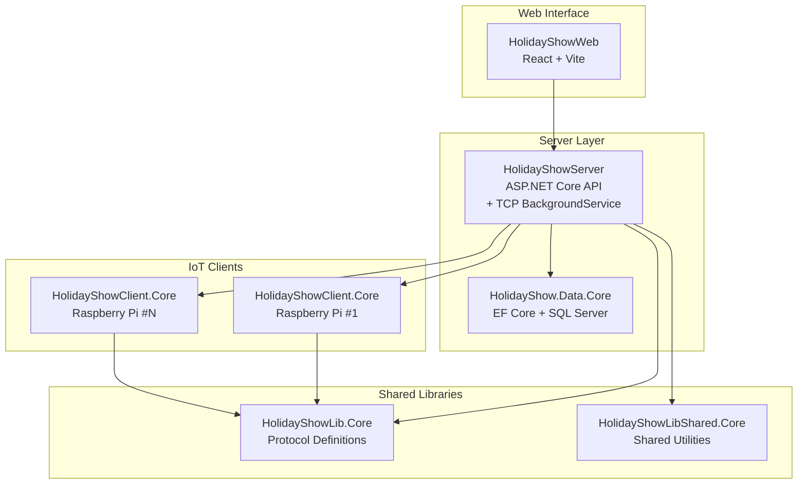
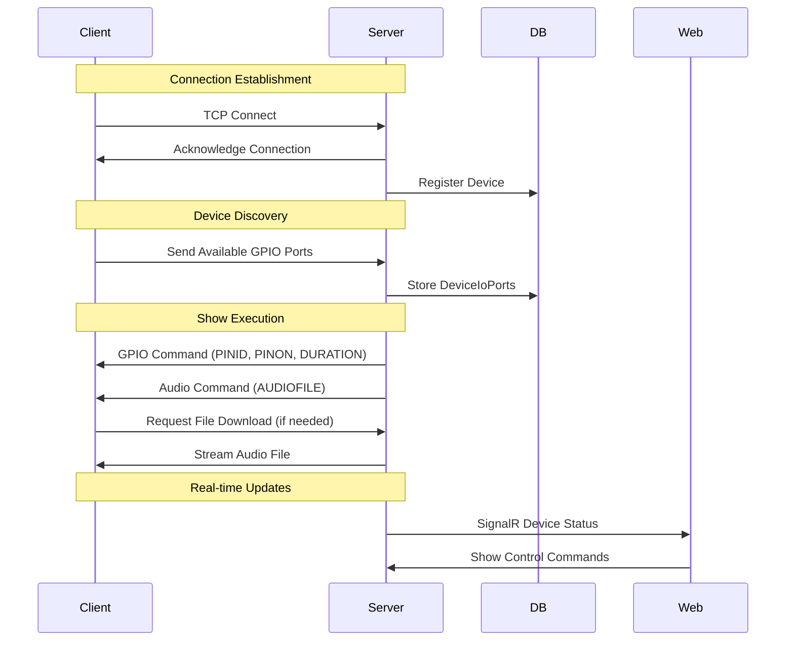
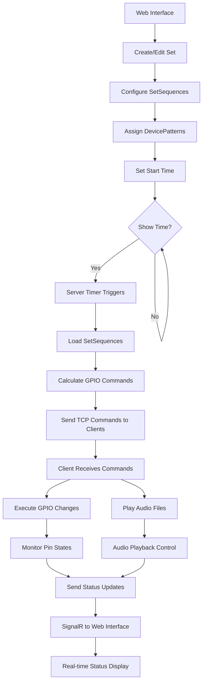
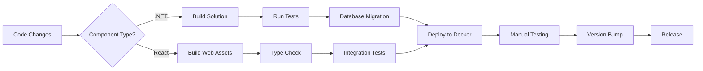

HolidayShow
===========

HolidayShow is a distributed IoT holiday light and fire show system that orchestrates synchronized light displays, audio playback, and special effects across multiple Raspberry Pi and Linux devices. The system uses a modern TCP-based client-server architecture with a React web interface for real-time show management.

Originally started in 2013 as a Mono/Raspberry Pi project, HolidayShow has evolved through multiple refactors to become a cross-platform .NET Core/Docker-based system supporting both Windows IoT and Linux deployments.

## Architecture Overview



## Key Components

### HolidayShowServer
- **ASP.NET Core Web API** with integrated TCP server as a BackgroundService
- **SignalR** for real-time device status updates to the web interface
- **Entity Framework Core** with SQL Server backend
- **TCP Protocol** handling for GPIO control and audio file distribution
- **Auto-migration** on startup for database schema updates

### HolidayShowClient.Core
- **IoT Client** for Raspberry Pi and Linux devices
- **TCP Connection** to server for receiving GPIO commands and audio files
- **Platform-specific GPIO** control (Windows IoT and Linux)
- **On-demand audio file** downloads and caching
- **Auto-reconnection** with keep-alive handling

### HolidayShowWeb
- **React Frontend** built with Vite for fast development
- **Material-UI** components with MobX state management
- **SignalR Integration** for real-time device status updates
- **OpenAPI-generated** TypeScript clients for backend communication
- **Responsive Design** for desktop and mobile management

### HolidayShow.Data.Core
- **Entity Framework Core** data layer
- **Partial Classes** for extensibility (AudioOptions, DevicePatterns, etc.)
- **Lazy Loading** enabled for navigation properties
- **Migration Support** for schema evolution

### Supporting Libraries
- **HolidayShowLib.Core**: Protocol message definitions and TCP communication helpers
- **HolidayShowLibShared.Core**: Shared utilities and service resolution patterns
- **HolidayShow.ConsoleTestClient**: Console application for TCP protocol testing

## TCP Communication Protocol

The system uses a custom TCP protocol for real-time GPIO control and audio synchronization:



### Key Protocol Messages
- **PINID**: GPIO pin identifier
- **DEVID**: Device identifier
- **DURATION**: Command duration in milliseconds
- **PINON**: Pin state (on/off)
- **AUDIOFILE**: Audio file to play
- **FILEDOWNLOAD**: Request file transfer

## Show Execution Process



## Key Features

- **Real-time Synchronization**: TCP-based commands ensure millisecond-accurate timing
- **Cross-platform Support**: Windows IoT, Linux, and Docker deployments
- **Web-based Management**: Modern React interface replaces legacy WPF editor
- **Audio Integration**: On-demand file downloads with caching
- **Device Auto-discovery**: GPIO ports automatically registered on connection
- **Effect System**: Programmable effects for complex light patterns
- **Safety Features**: "Danger Pins" can be disabled remotely
- **Docker Support**: Containerized deployments for easy scaling

## Development Environment

### Prerequisites
- **Windows 10/11** or **Linux/macOS**
- **.NET 8.0 SDK** or higher
- **Node.js 18+** and npm
- **SQL Server** (Express edition works) or Docker
- **Visual Studio 2022** or **VS Code** with C# and TypeScript extensions

### Quick Start

```bash
# Clone the repository
git clone https://github.com/TWhidden/HolidayShow.git
cd HolidayShow

# Build all components
npm run build-all

# Start with Docker (recommended)
docker-compose up

# Or run locally
# 1. Start SQL Server
# 2. Update connection strings in appsettings.json
# 3. Run server: dotnet run --project HolidayShowServer
# 4. Run web: cd HolidayShowWeb && npm run dev
```

### Development Workflows



### Common Development Tasks

```bash
# Database operations
npm run ef-migrate-db

# Build specific architectures
npm run build-x64
npm run build-arm64

# Docker development
npm run docker-run-shell

# Version management
npm run server-patch
npm run web-minor
npm run client-patch
```

## Configuration

### Connection Strings
- **Server**: `appsettings.json` with key `"EfHolidayContext"`
- **Web Proxy**: `HolidayShowWeb/vite.config.ts` proxies to ASP.NET Core backend
- **Default Development**: SQL Server on port 1401 with dev/dev123 credentials

### Platform-Specific Setup
- **GPIO Access**: Conditional compilation for Windows IoT vs Linux
- **Logging**: Serilog to `/var/log/HolidayShowServer/` in containers
- **File Paths**: Audio files stored in configurable directories

## Examples in Action

- **2015 Halloween**: Fire/Lights/Music synchronization - [YouTube](https://youtu.be/APfoZEe-HvU)
- **2014 Event**: 3,000+ attendees - [YouTube](https://www.youtube.com/watch?v=7LtSyZfghlU)
- **2013 Original**: Mono/Raspberry Pi prototype - [YouTube](https://www.youtube.com/watch?v=RIQrfBfR6y4)

## Screenshots

### Device Status (Real-time Web Interface)
Devices connect via TCP and report status through SignalR to the React frontend.

### Sets Editor
Configure synchronized sequences across multiple devices with precise timing.

### Effects Editor
Program reusable effects like strobes and continuous patterns.

### Audio Editor
Manage audio files with automatic duration detection and on-demand downloads.

## Special Notes

**This is "get-it-done" software**: Prioritizing functionality over enterprise patterns, HolidayShow has evolved organically since 2013. Each holiday season brings new features and improvements.

**Safety First**: When using gas valves or high-power equipment, always implement proper safety measures and remote disable capabilities.

**Community**: Originally a personal project, HolidayShow now serves as a reference for IoT orchestration, TCP protocols, and real-time distributed systems.
